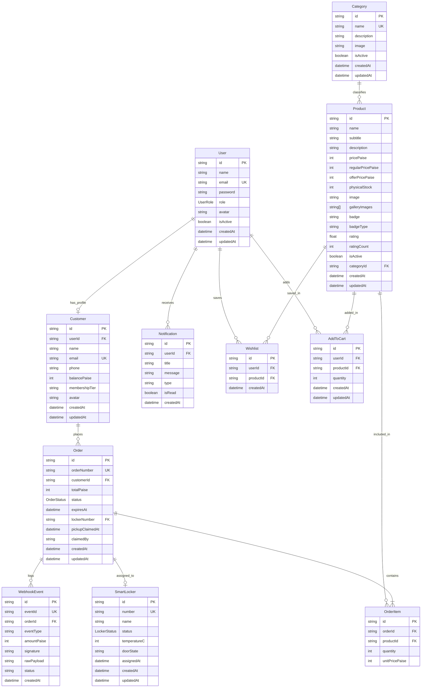

# QuickPick Counter — Database Design & Schema Architecture

## 1. Overview & Core Principles

The QuickPick Counter persistence layer is built on **PostgreSQL** via **Prisma ORM**, engineered for high concurrency, financial precision, and idempotent webhook processing.

### Key Architectural Tenets
1. **Integer Paise Representation**: All monetary quantities (`pricePaise`, `regularPricePaise`, `offerPricePaise`, `totalPaise`, `amountPaise`) are stored as 32-bit integers in paise (e.g., ₹35.00 $\rightarrow$ `3500`), avoiding IEEE-754 floating-point rounding errors.
2. **Physical Stock vs. Available Holds**:
   - `physicalStock` represents the actual count of inventory units currently sitting in dispenser compartments.
   - `availableUnits` is dynamically calculated:
     $$\text{Available Units} = \text{physicalStock} - \sum_{\text{unpaid orders where } \text{expiresAt} > \text{NOW}()} \text{quantity}$$
   - When an order is created, stock is **reserved** via a 120-second hold. Physical stock is only permanently decremented on successful **pickup claim**, ensuring stock is never held or deducted twice.
3. **Locker Hardware State**:
   - Tracks 12 smart dispenser compartments (`L-01` to `L-12`) with explicit states: `AVAILABLE`, `RESERVED`, `OCCUPIED`, `OUT_OF_SERVICE`.
4. **Strict Webhook Idempotency**:
   - `WebhookEvent` stores incoming payment captures keyed by a globally unique `eventId` with unique constraint enforcement to eliminate replay and duplicate capture hazards.

---

## 2. Entity Relationship Diagram (ERD)



---

## 3. Database Schema Models

### A. `User`
Centralized credentials and role-based authentication entity.
- `id` (String `@id @default(cuid())`): Unique user identifier.
- `name` (String): Display name / staff name.
- `email` (String `@unique`): Login email address.
- `password` (String): Bcrypt-hashed password.
- `role` (`UserRole`): `ADMIN` (station manager) or `CUSTOMER` (kiosk shopper).
- `avatar` (String?): Avatar image or initial letter.
- `isActive` (Boolean `@default(true)`): Account status flag.
- `createdAt` / `updatedAt`: Timestamps.

### B. `Customer`
Kiosk patron profile, contact info, and prepaid balance.
- `id` (String `@id @default(cuid())`): Unique customer profile identifier.
- `userId` (String `@unique`): Foreign key to `User` entity (1-to-1 relation).
- `name` (String): Customer display name.
- `email` (String `@unique`): Customer email.
- `phone` (String?): Mobile number for pickup SMS alerts.
- `balancePaise` (Int `@default(0)`): Available wallet / prepaid credit balance in paise (e.g. ₹500.00 = 50000).
- `membershipTier` (String `@default("Bronze Member")`): Loyalty tier ('Gold Member', 'Silver Member', 'Bronze Member').
- `avatar` (String?): Customer profile picture / avatar.
- `createdAt` / `updatedAt`: Timestamps.
- `orders`: Relation array linking to `Order[]`.

### C. `Category`
Master categorization for customer kiosk screens and admin management.
- `id` (String `@id @default(cuid())`): Unique primary key.
- `name` (String `@unique`): e.g. "Snacks", "Drinks", "Chocolates", "Biscuits", "Combos".
- `description` (String?): Optional display description.
- `image` (String?): Representative thumbnail URL.
- `isActive` (Boolean `@default(true)`): Kiosk catalog visibility toggle.
- `createdAt` / `updatedAt`: Automatic timestamp auditing.

### D. `Product`
Physical snack items available for automated vending.
- `id` (String `@id @default(cuid())`): Unique product identifier.
- `name` (String): e.g. "Lay's Classic Salted".
- `subtitle` (String?): Short packaging subhead.
- `description` (String?): Ingredients, tasting notes, allergens.
- `pricePaise` (Int): Active selling price in paise.
- `regularPricePaise` (Int?): Regular MSRP in paise.
- `offerPricePaise` (Int?): Discounted sale price in paise.
- `physicalStock` (Int `@default(0)`): Units currently present in machine shelves.
- `image` (String): Primary product image URL.
- `galleryImages` (String[]): Multi-angle gallery images.
- `badge` (String?): "Bestseller", "Chilled", "Low Stock".
- `badgeType` (String?): "red", "amber", "green".
- `rating` (Float `@default(4.8)`): Average customer review score.
- `ratingCount` (Int `@default(0)`): Number of reviews.
- `isActive` (Boolean `@default(true)`): Active selling status.
- `categoryId` (String?): Foreign key to `Category`.

### E. `Order`
Transactional checkout requests, stock reservations, and payment lifecycles.
- `id` (String `@id @default(cuid())`): Internal order identifier.
- `orderNumber` (String `@unique`): Human-readable order reference (e.g. `ORD1234`).
- `customerId` (String?): Foreign key linking order to `Customer`.
- `customer`: Relation back to `Customer` entity.
- `totalPaise` (Int): Total computed amount in paise.
- `status` (`OrderStatus`): `UNPAID` | `PAID` | `EXPIRED` | `NEEDS_REVIEW` | `CLAIMED`.
- `expiresAt` (DateTime): Exact UTC timestamp when the 120s reservation ends.
- `lockerNumber` (String?): Assigned dispenser compartment (e.g. `L-07`).
- `pickupClaimedAt` (DateTime?): Timestamp when locker door unlocked for customer.
- `claimedBy` (String?): Verification identifier (PIN / Webhook confirmation).

### F. `OrderItem`
Itemized line items linking products to orders.
- `id` (String `@id @default(cuid())`): Line item primary key.
- `orderId` (String): Foreign key to `Order`.
- `productId` (String): Foreign key to `Product`.
- `quantity` (Int): Units requested ($\ge 1$).
- `unitPricePaise` (Int): Snapshot price at time of order creation.

### G. `SmartLocker`
Physical dispensing compartments in station unit.
- `id` (String `@id @default(cuid())`): Locker internal ID.
- `number` (String `@unique`): Compartment identifier (`L-01` to `L-12`).
- `name` (String?): Friendly label.
- `status` (`LockerStatus`): `AVAILABLE` | `RESERVED` | `OCCUPIED` | `OUT_OF_SERVICE`.
- `temperatureC` (Int `@default(21)`): Real-time compartment telemetry.
- `doorState` (String `@default("locked")`): 'locked' | 'unlocked' | 'open'.
- `assignedAt` (DateTime?): Last order assignment timestamp.

### H. `WebhookEvent`
Idempotent audit log of payment gateway callbacks.
- `id` (String `@id @default(cuid())`): Webhook entry primary key.
- `eventId` (String `@unique`): Idempotency key from payment gateway (UPI/Razorpay/Stripe).
- `orderId` (String?): Referenced order.
- `eventType` (String): 'payment.captured', 'payment.failed'.
- `amountPaise` (Int?): Received payment amount.
- `signature` (String): Verified HMAC-SHA256 signature string.
- `rawPayload` (String): Unaltered raw body payload.
- `status` (String): 'PROCESSED', 'AMOUNT_MISMATCH', 'LATE_PAYMENT', 'IGNORED'.

### I. `Notification`
Customer and admin transactional notifications & telemetry alerts.
- `id` (String `@id @default(cuid())`): Unique notification ID.
- `userId` (String): Foreign key to `User`.
- `title` (String): Alert title.
- `message` (String): Message body.
- `type` (String): 'info', 'warning', 'success', 'error'.
- `isRead` (Boolean `@default(false)`): Read status indicator.
- `createdAt` (DateTime): Timestamp.

### J. `Wishlist`
Saved customer snacks for fast one-tap ordering.
- `id` (String `@id @default(cuid())`): Unique wishlist item ID.
- `userId` (String): Foreign key to `User`.
- `productId` (String): Foreign key to `Product`.
- `createdAt` (DateTime): Timestamp.

### K. `AddToCart`
Persistent customer shopping cart items across kiosk visits.
- `id` (String `@id @default(cuid())`): Unique cart item ID.
- `userId` (String): Foreign key to `User`.
- `productId` (String): Foreign key to `Product`.
- `quantity` (Int `@default(1)`): Item quantity.
- `createdAt` / `updatedAt`: Timestamps.

---

## 4. Indexing & Concurrency Constraints

| Table | Index Columns | Purpose |
| :--- | :--- | :--- |
| `User` | `[email]` (**UNIQUE**) | Fast login lookups for admin and customers |
| `User` | `[role]` | Role-based permission queries |
| `Customer` | `[userId]` (**UNIQUE**) | Fast 1-to-1 link from user session to customer balance |
| `Customer` | `[email]` (**UNIQUE**) | Customer contact search |
| `Customer` | `[phone]` | Fast mobile number lookup for kiosk OTP / SMS |
| `Notification` | `[userId]`, `[isRead]` | Quick unread notification badge count |
| `Wishlist` | `[userId, productId]` (**UNIQUE**) | Prevent duplicate wishlist items |
| `AddToCart` | `[userId, productId]` (**UNIQUE**) | Fast upsert / quantity modification |
| `Product` | `[categoryId]` | Fast category catalog filtering |
| `Product` | `[isActive]` | Quick retrieval of kiosk-ready inventory |
| `Order` | `[customerId]` | Fast order history retrieval for logged-in customers |
| `Order` | `[status]` | Fast filtering for active orders and pending holds |
| `Order` | `[expiresAt]` | Efficient queries for active stock holds and expiry checks |
| `Order` | `[lockerNumber]` | Quick lookup of current compartment assignments |
| `OrderItem`| `[orderId]`, `[productId]` | Efficient joins for order item breakdown and stock checks |
| `SmartLocker`| `[status]` | Fast query to find first available compartment |
| `WebhookEvent`| `[eventId]` (**UNIQUE**) | Hardware & payment gateway replay protection |

---

## 5. Stock Reservation & Concurrency Strategy

1. **Deadlock-Free Locking**: When reserving stock for an order containing multiple items, products are locked using row-level locking (`SELECT ... FOR UPDATE`) ordered strictly by `id ASC`.
2. **Atomic Hold Validation**:
   Within an explicit transaction:
   ```sql
   SELECT p.id, p."physicalStock",
          COALESCE(SUM(oi.quantity), 0) AS "heldStock"
   FROM "Product" p
   LEFT JOIN "OrderItem" oi ON oi."productId" = p.id
   LEFT JOIN "Order" o ON o.id = oi."orderId"
       AND o.status = 'UNPAID'
       AND o."expiresAt" > NOW()
   WHERE p.id IN (...)
   GROUP BY p.id
   FOR UPDATE OF p;
   ```
   If any requested quantity exceeds $(\text{physicalStock} - \text{heldStock})$, the entire transaction aborts and returns an error without partial allocation.
3. **Single-Winner Pickup Claim**:
   ```sql
   UPDATE "Order"
   SET status = 'CLAIMED', "pickupClaimedAt" = NOW()
   WHERE id = :orderId AND status = 'PAID'
   RETURNING *;
   ```
   If 0 rows are updated (e.g. losing concurrent claim or unpaid), HTTP 409 Conflict is returned immediately.
